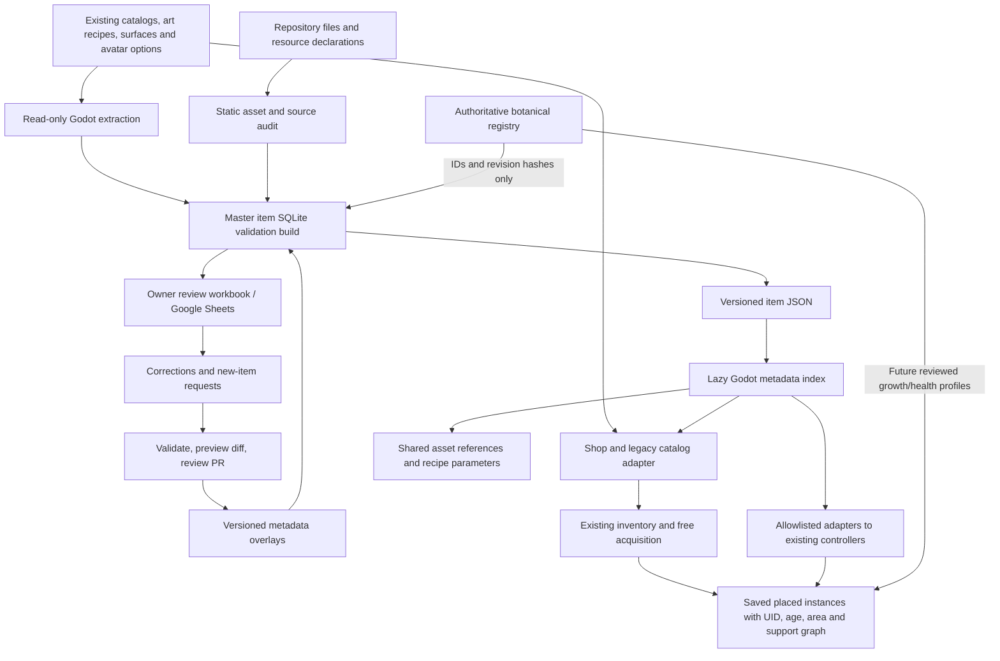

# Master world item catalog — audited foundation and Godot adapter

This milestone catalogs every existing evaluated shop entry, stage variant, ground
material/border, supported avatar option and central scenery recipe. It inventories
all repository source files plus resource files, embedded glTF/scene resources,
functions, static asset references and documented future requirements. It does not
turn every source asset into an obtainable item or turn future design notes into
working mechanics. The original source code, artwork and botanical records remain.

## Architecture



The authoring database never stores player gardens or large binary assets. It stores
asset paths/hashes and provenance. The botanical database remains authoritative for
identity, research and physiology: the item database holds only botanical IDs,
registry revision hashes and unresolved legacy growth mappings. It does not copy
botanical trait collections into another scientific database.

## Reproduce the audit and build

From the repository root:

```sh
python -m pip install -r tools/item_catalog/requirements-dev.txt
godot --headless --path the-allotment-garden-world-v-02 --editor --import --quit
godot --headless --path the-allotment-garden-world-v-02 --script "$PWD/tools/item_catalog/extract.gd" -- /tmp/items-extracted.json
python -m tools.item_catalog.catalog build --out .item-build/v1
python -m tools.item_catalog.workbook --build .item-build/v1 --out .item-build/MasterItems.xlsx
python -m unittest tools.item_catalog.test_catalog tools.botanical.test_foundation -v
python -m tools.item_catalog.check_godot --out .item-build/godot-tests
```

The extractor uses actual evaluated constants, actual `Catalog.by_id` values, fitted
mesh bounds, material roles and current collision geometry. It creates no player
save. Use temporary XDG data/config/cache locations for engine checks; the provided
suite runner creates a separate temporary profile for every suite and times out
assertion failures. Import resources before extraction so atlas/icon loaders exist.

`source_snapshot.json` is a checked-in audit input captured from main plus this
compatible adapter. Refresh it deliberately with the extractor after changing a
source catalog, inspect the diff, and preserve its provenance fields. It is not a
second manually edited shop. `catalog.v1.json` is a checked-in runtime export needed
by Godot. Each entity occupies one JSON line to avoid tens of thousands of repeated
formatting lines. SQLite, CSV exports, thumbnail crops, workbooks and logs remain
under ignored `.item-build/` and are not committed. No binary image/model was added.

The SQLite importer preserves original and resolved listing objects in
`item.definition_json`. The runtime JSON omits redundant original listing copies;
those remain available through SQLite and the source snapshot. The input hash covers
repository source bytes; the content hash covers the complete exported bundle.

## Inventory and status

The current catalog has **262 item definitions**:

- **159 shop entries:** 111 base entries including the two historical seed packet
  IDs, plus 48 generated seed/seedling/young forms across 16 growing profiles.
- **84 surface definitions:** 83 ground covers and one border material. These are
  functional editor choices, not bag items or shop purchases.
- **Nine scenery definitions:** central planter, shed, greenhouse, stall, bed and
  four old generic foliage recipes. These are not new shop entitlements. Five gate
  leaf recipes are separately registered as shared asset components, not items.
- **10 avatar choices:** four hairstyles, two outfits and four accessory toggles.
  They use existing avatar geometry; only the existing straw-hat listing is a shop
  item. Appearance choices are not ten newly created models.

Shop entries have functional local acquisition/placement where available and
prototype art pending owner review. Gates have existing proximity/hinge behavior.
Fountains have visual water motion, not physical water simulation or an operating
switch. The watering can is decorative. Seating, harvesting, selling, crafting and
repair remain contracts; there are no verified harvest products or craft recipes
to fabricate into the inventory. Dates/statuses in design documents are evidence of
specification only; the requirement inventory labels them accordingly.

Audit outputs include file paths and statuses in the Master, Assets, References,
Symbols, Requirements and Issues tabs/SQLite tables. A zero literal incoming
reference is an **unused candidate**, not proof of dead content: dynamic ID-based
loading, staging and exported scenes may still use it. Dynamic HUD path templates
are distinguished from missing files. Unbuilt rose-spec paths are planned-path
issues, not broken live assets. Eight groups of byte-identical SVGs are reuse
candidates; original files and licenses are retained. Generic scenery `tree` and
the living oak item are deliberately different recipes and identities.

## Major tables and relationships

Executable definitions and constraints are in `schema.sql`.

| Table | Role |
|---|---|
| source_file | Full repository file census, SHA-256, size and file kind; binary bytes stay outside SQLite |
| source_symbol | Source file, line and named function; runtime/reusable, test or staging scope |
| requirement | Source file/line for documented future work; never auto-classified as implemented |
| category | Namespaced categories, parent categories and labels |
| item | Permanent ID, external domain/ID, parent, category/collection, text, revision, full source definition and independent statuses |
| external_id | Unique `(domain, legacy_id)` mapping; avoids collisions without rewriting old saves |
| listing | Independent listing ID, item FK, historical/effective prices, availability, currency, stack limit and optional restrictions |
| physical | Measured dimensions/pivot, existing footprint/clearance rules; unknown mass/attachments/suitability stay null |
| asset | File or embedded/procedural resource identity, path/fragment, hash, license evidence and independent review status |
| asset_reference | Literal, glTF, dynamic-template or specification dependency with source path |
| item_asset | Many-to-many bindings with role and variant/stage/material parameters |
| asset_component | Shared model/material/gate-leaf dependencies; component graph, not duplicated geometry |
| behavior | Versioned functionality contract, current status, source script/method and save requirements |
| item_behavior | Only capabilities actually justified by that item; no decorative-tool watering capability |
| botanical_reference | External authoritative botanical handle and source revision; not copied biological research |
| botanical_link | Item → botanical ID or unresolved legacy profile; optional future botanical product reference |
| change_history | Revision-checked before/after change, reviewer, UTC date, reason and unique change ID |
| issue | Missing/planned/dynamic references, byte duplicates, unresolved botanical mappings and functionality gaps |

The original item ID is unchanged for all shop entries, including `@seed`,
`@seedling`, `@young`, `sunflower_seeds` and `basil_seeds`. Authoring-only non-shop
namespaces are `surface:<original-id>`, `scenery:<recipe-id>` and
`avatar:<group>:<option>`; existing domain IDs remain in `external_id`. This avoids
colliding with live IDs such as the living `tree`. Asset file IDs are `asset:<path>`,
embedded resources add a fragment, recipes use `recipe:<recipe>`, and shared
materials use `material:mesh_builder:<role>`. Asset path renames need an explicit ID
migration/alias review; do not silently change stable references.

## Reuse, dimensions and behavior

Plant-stage listings share a base model recipe and pass their existing stage/profile
parameters. Gates link separate leaf geometry to their base models and reuse the
existing proximity/hinge controller. Materials reference the existing mesh-builder
role and shader pipeline. Surface variants share the existing surface shader and
per-placement style parameters. Avatar choices share the rigged model and embedded
animations/materials inventoried from glTF. Different silhouettes, dimensions,
foliage, flowers, finishes and actual assets remain distinct.

Dimensions are measured in metres from fitted model bounds, not inferred from file
names. The physical definition also captures current collision shapes, position and
rotation, mature reservation dimensions, stack footprints and support surfaces.
These are current implementation measurements, not universal botanical size claims
or final art approval. Ground materials are surfaces; no fake object height or mass
is assigned. Growth/scale and placement regression tests retain mature clearances,
curb protections, support ordering and visitor limitations.

`behavior_router.gd` dispatches only four explicit existing operations: free bag
acquisition, retrieval, placement start and gate opening. It requires the item
capability, exact existing target script and valid arguments. It does not invoke
methods or load scripts named by spreadsheet cells. Other implemented visual or
geometry components are referenced, not duplicated. Planned actions return false;
they cannot be activated by changing a status cell. Transient proximity/light state
is distinguished from saved inventory/age/placement state.

## Godot integration and compatibility

`features/item_catalog/master_catalog.gd` loads metadata on demand, builds ID and
category indexes, returns defensive copies, searches words/tags, selects stage
variants and resolves asset metadata. It does not preload high-detail meshes or
execute asset paths. It rejects duplicate IDs, bad versions, unsafe paths, unknown
bindings, invalid dimensions and variant cycles. An invalid replacement preserves
the previous good in-memory index. Missing paths return an unavailable descriptor.

The live shop now uses a one-time index of its **unchanged source array** rather than
a linear scan. `Catalog.master_record(id)` exposes the new metadata. The source array
still owns live purchase/placement fields during this migration: a missing/bad
export does not make old items or saves disappear. This is an incremental query
adapter, not replacement of the shop UI/save loader with editable spreadsheet data.

All historical price numbers are preserved, but effective purchase price remains
zero and Rune balances remain untouched. Resale values, durability and crafting
costs stay null/contracts. Existing item limits, mature age interpretation, profile
IDs, region scopes and save version 1 persist. Definition IDs, listing IDs, plant
identities and placed instance UIDs remain distinct. Future health/lineage/harvest
requires nonfungible instance state, not an age-only stack; no instance migration is
attempted here. The four newer woody profiles remain explicit unresolved botanical
mappings across 16 stage forms, rather than inventing four botanical records.

## Owner workflow on iPad

The workbook has the ten requested subject areas, plus botanical, shared-component,
issue, source-symbol and future-requirement views. Headers/IDs are frozen, source
views are protected against accidental edits, filters are enabled, and correction
decisions use controlled values. Actual existing SVGs/atlas regions are rendered as
thumbnail evidence, never substituted model previews. Every thumbnail retains its
source path and atlas coordinates. Full licensing and source fragments remain in
the asset library. Protection is not a substitute for Google account permissions.

To correct an item:

1. Copy item ID and revision from Master Item Catalog into Owner Corrections.
2. Supply a unique change ID, `set` or explicit `clear`, supported field, JSON value,
   decision, reviewer, UTC reviewed_at and reason. Empty cells never mean deletion.
3. Export only that tab as UTF-8 CSV and validate it:

```sh
python -m tools.item_catalog.catalog review --database .item-build/v1/items.sqlite --changes /tmp/Corrections.csv --out /tmp/item-overlay.json
python -m tools.item_catalog.catalog build --out .item-build/v2 --overlay /tmp/item-overlay.json
```

Accepted metadata fields are `name`, `description`, `tags` and `owner_notes`.
Identity, economy, assets, physical rules and behaviors require a reviewed content
publication change, not arbitrary cell mutation. Overlays contain exact base
revisions and history; stale/conflicting edits and reused change IDs are rejected.
An identical retry is a no-op. Previous overlays/builds provide rollback without
rolling back saves. Live shop dictionaries remain intact even after metadata edits.

To propose a new item:

```sh
python -m tools.item_catalog.catalog requests --database .item-build/v1/items.sqlite --source /tmp/NewRequests.csv --out /tmp/item-requests.json
```

This validates unique request IDs and related-item references and retains owner
decisions in a receipt. Approval of a request does not create a functional item.
For a new item or variant, next prepare a reviewed definition with immutable ID,
category, source/license, existing or new base design, metre dimensions, existing
capabilities and optional legacy/botanical links. Add only mechanics it actually
uses; retain null for unknown/irrelevant attributes. Attach actual assets/previews
by validated project path, hash and role. Reuse a model/material/animation by ID and
store only meaningful overrides. Run extraction, rebuild, schema/reference checks,
engine regressions and owner art review before publishing a versioned runtime diff
in a feature PR. Never infer cultivar identity or a new harvest product from a shop
label or illustration. Planned additions stay requests until these gates pass.

## Additional safeguards and remaining work

- Multiple listings can reference one item; future vendor/season/unlock rules must
  not duplicate the item definition or quietly activate prices.
- Distinguish fungible stacks, individually aged plants, compound hedge members,
  support assemblies and cosmetic avatar options. Future receipts and inventory
  operations need idempotent event IDs and atomic state transitions.
- Reserve retired IDs/tombstones and explicit aliases for released saves. Unknown
  legacy items must not cause whole-save loss when a future catalog retires content.
- Embed provenance at the claim/asset revision level; artistic approval, source
  verification, technical testing and implemented behavior are separate decisions.
- Future work needs localized display/search keys, accessibility beyond color,
  unit conversion, licensing expiry/restrictions, target-device draw-call/LOD/texture
  budgets, spatial/collision budgets and data/payload limits. Current search scans
  metadata only; exact lookups are indexed and load no high-detail geometry.
- Add typed profiles for prices/recipes, durability, sockets, operating conditions,
  product/seed lots, structural load/slope rules and authoritative ownership only
  when the corresponding mechanic is approved. The current JSON schema is a
  versioned envelope; arbitrary future domain mechanics are not validated science.
- Native Google Sheets is a review surface, not a live game dependency. Native
  publication must be verified by ID/URL/readback; a local workbook is never
  represented as an already hosted sheet.

The completed milestone is an audited catalog, relational/review foundation,
reusable reference library and compatible Godot metadata/source-index adapter.
It does not add sitting, harvesting, fluid simulation, repairs, commerce or a new
inventory format. Those require separate tested feature increments and owner
review where gameplay/design changes are consequential.
